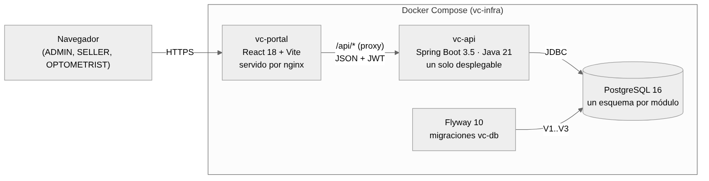
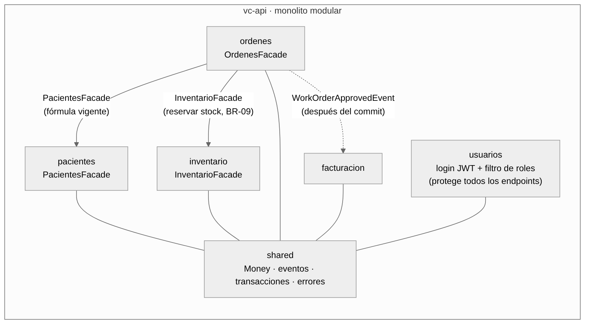
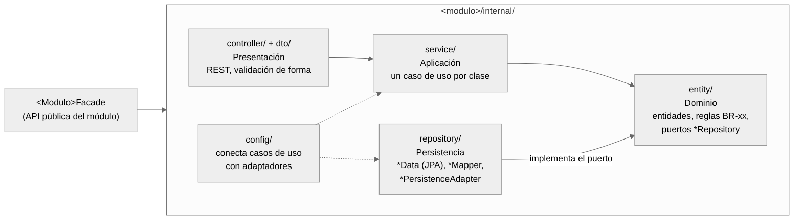
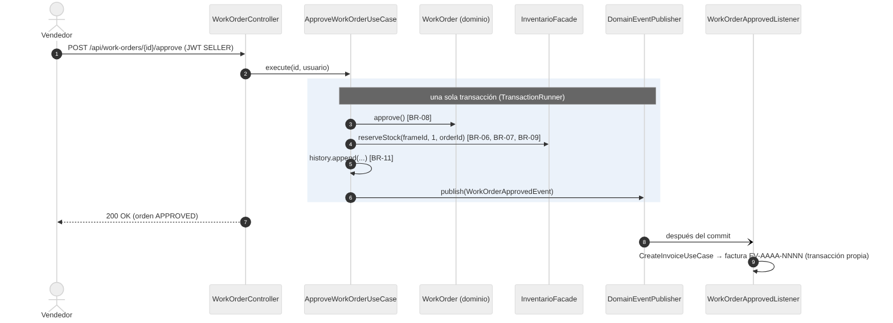
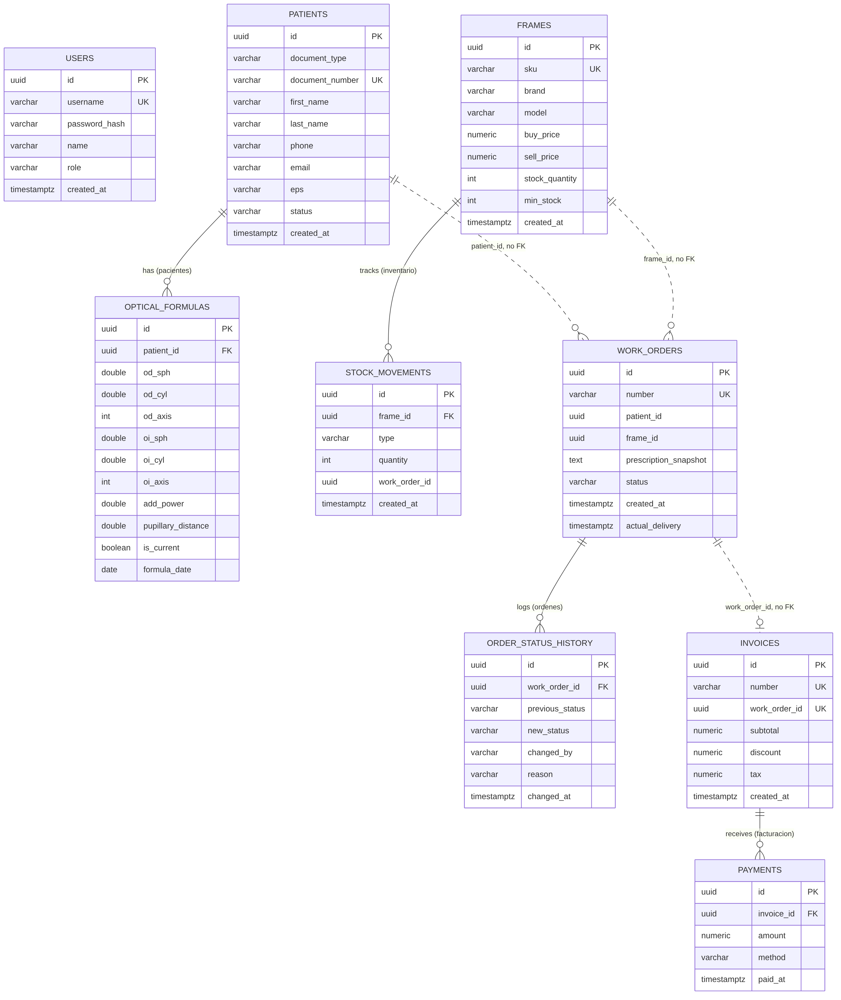

# Arquitectura de VisionCare v1.0.0

Fuente: decisiones de arquitectura de VisionCare (`vc-docs/05-architecture`, ADR-001 a ADR-004). Los
diagramas están como código Mermaid (`*.mmd`) junto a su imagen (`*.png`), así que se pueden editar y
volver a generar con `mmdc -i archivo.mmd -o archivo.png`.

## 1. Estilo arquitectónico: monolito modular en capas

VisionCare es **un solo desplegable** (`vc-api`) dividido en **cinco módulos de negocio** (pacientes,
inventario, ordenes, facturacion, usuarios) más un módulo `shared` de utilidades. Cada módulo expone una
**fachada pública** (`<Modulo>Facade`) y oculta todo lo demás dentro de `internal/`. Dentro de cada
módulo, el código se organiza en **cuatro capas**: presentación, aplicación, persistencia y dominio.

### Justificación (ADR-001)

| Restricción del proyecto | Cómo la atiende el monolito modular |
|---|---|
| Un desplegable, una base de datos, un pipeline | Un solo `vc-api` y un solo PostgreSQL: no hay red entre servicios ni consistencia eventual que operar |
| Cinco contextos de negocio con vocabulario propio | Cada contexto es un módulo con frontera explícita: un cambio en facturación no toca pacientes |
| Equipo académico sin persona dedicada a operaciones | Microservicios exigirían orquestar 5 despliegues; aquí basta `docker compose up` |
| NFR-08: primera petición exitosa en menos de 1 hora | Un solo proyecto Maven y un solo `docker compose` |

**Alternativas descartadas:** capas planas sin módulos (con cinco contextos, cualquier clase podría
importar cualquier otra) y microservicios (costo operativo injustificado para el tamaño del equipo y del
sistema).

### Otras decisiones

| ADR | Decisión | Efecto en la mantenibilidad |
|---|---|---|
| ADR-002 | Un esquema de PostgreSQL por módulo, sin llaves foráneas entre esquemas | La propiedad de cada tabla es visible; un módulo no puede hacer *join* con tablas de otro |
| ADR-003 | `ordenes` llama a `InventarioFacade` en la misma transacción (BR-09); la factura se crea por evento después del commit | El descuento de stock es atómico y `ordenes` no conoce la facturación (bajo acoplamiento) |
| ADR-004 | JWT sin estado; roles ADMIN, SELLER y OPTOMETRIST; 401 sin token y 403 sin rol | La seguridad es transversal (un filtro), no está repetida en cada caso de uso |

## 2. Diagramas

### 2.1 Despliegue



El navegador solo habla con `vc-portal` (nginx). nginx reenvía `/api/*` a `vc-api`. Flyway aplica las
migraciones de `vc-db` antes de que arranque la API.

### 2.2 Módulos y dependencias



Solo hay **tres dependencias entre módulos**, y todas pasan por la API pública. `ordenes` usa las
fachadas de `pacientes` (fórmula vigente) y de `inventario` (reservar stock), y `facturacion` reacciona
al evento `WorkOrderApprovedEvent` sin importar nada de `ordenes.internal`. Las reglas ArchUnit de
`ModuleBoundariesTest` hacen fallar el build si alguien importa el `internal` de otro módulo.

### 2.3 Capas dentro de un módulo



Las dependencias van hacia el dominio. `entity/` no depende de Spring ni de JPA: declara puertos
(`*Repository`) que `repository/` implementa con adaptadores JPA (`*PersistenceAdapter`). `config/` es la
raíz de composición que conecta casos de uso y adaptadores. Por eso las clases `*Config` tienen CBO 11 en
la suite CK, y en el análisis se justifica no cambiarlas.

### 2.4 Flujo principal: aprobar una orden de trabajo (RF-07 y RF-10)



### 2.5 Modelo de datos



Las relaciones marcadas *"no FK"* cruzan esquemas de módulos distintos. Se guardan como UUID simple y se
validan a través de la fachada del módulo dueño (ADR-002).

## 3. Estructura del proyecto

```
vc-api/src/main/java/co/visioncare/vcapi/
├── Application.java
├── pacientes/
│   ├── PacientesFacade.java          <- API pública del módulo
│   └── internal/                     <- nadie fuera del módulo puede importarlo
│       ├── controller/  dto/         <- presentación
│       ├── service/                  <- aplicación: un caso de uso por clase
│       ├── entity/                   <- dominio: entidades, reglas BR, puertos
│       ├── repository/               <- persistencia: JPA, mappers, adaptadores
│       └── config/                   <- conexión de dependencias
├── inventario/   (misma estructura)
├── ordenes/      (misma estructura + WorkOrderApprovedEvent público)
├── facturacion/  (misma estructura + WorkOrderApprovedListener)
├── usuarios/     (misma estructura + security/: filtro y proveedor JWT)
└── shared/       (money, events, tx, exceptions, rest, config)

vc-portal/src/
├── api.ts  auth.tsx  useApi.ts  lib.tsx  toast.tsx  theme.tsx
├── components/   (Layout, Field)
└── screens/      (una pantalla por ruta: Patients, PatientDetail, Inventory, WorkOrderNew, ...)
```

## 4. Relación con las métricas

La arquitectura explica gran parte de los resultados del análisis:

- **Backend con V(G) máx. 4 y MI ≥ 80:** "un caso de uso por clase" produce métodos cortos con una sola
  responsabilidad.
- **CBO promedio 2,8:** las fronteras entre módulos (fachadas + ArchUnit) mantienen bajo el acoplamiento.
  Las excepciones son los controladores (un caso de uso inyectado por endpoint) y las clases `config/`.
- **Frontend con V(G) hasta 22:** `vc-portal` no tiene una arquitectura equivalente. No separa
  componentes de presentación, hooks de estado ni validación, y cada pantalla concentra todo. Las
  propuestas P1 y P3 llevan al frontend la misma separación que ya tiene el backend.
