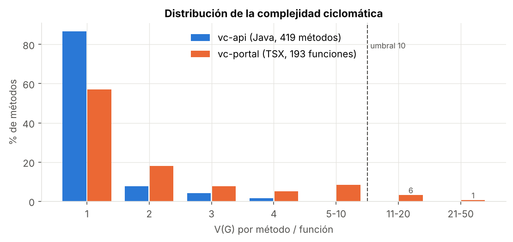
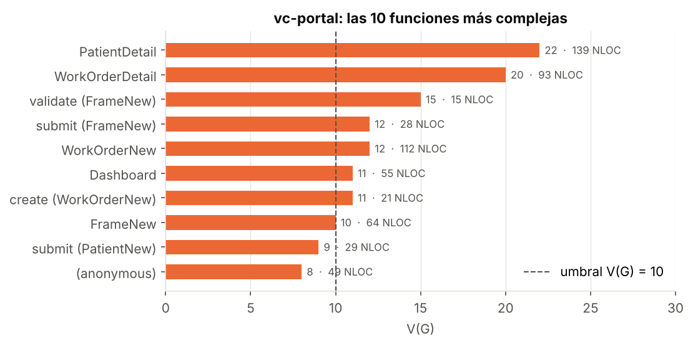
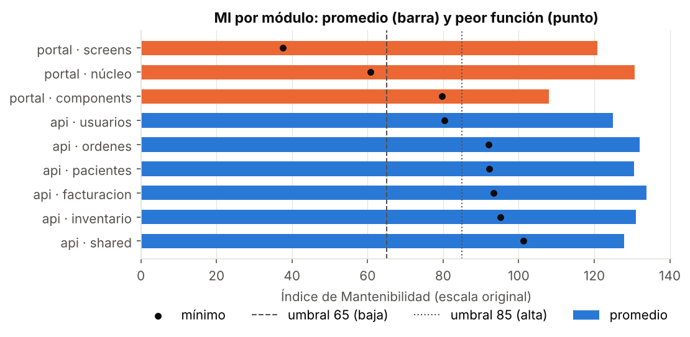
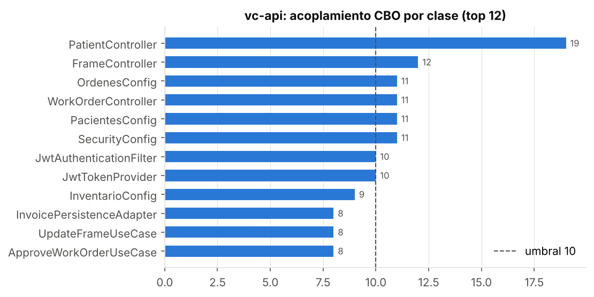
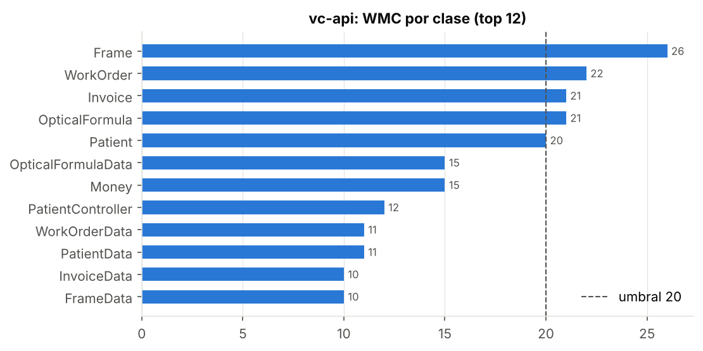
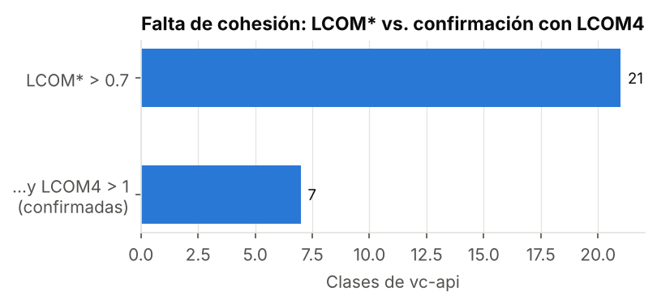
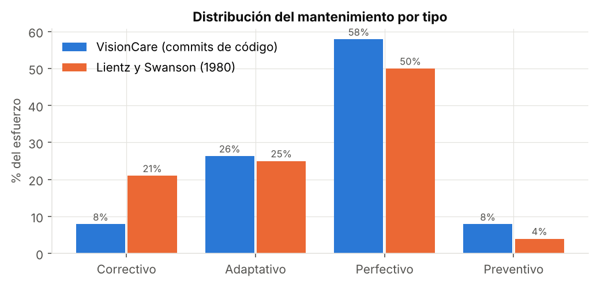

# Resultados de las métricas

Medición sobre **VisionCare v1.0.0** (etiqueta `v1.0.0` de la rama `qa` de cada repositorio).
Los datos completos están en `metricas/resultados/` (CSV) y se regeneran con los comandos del README.

## 0. Visión general

| | vc-api (backend) | vc-portal (frontend) |
|---|---|---|
| Lenguaje | Java 21 · Spring Boot 3.5 | TypeScript 5.6 · React 18 |
| Archivos medidos | 146 | 23 (sin pruebas ni `index.css`) |
| Tipos (clases, records, enums, interfaces) | 154 | n/a (componentes funcionales) |
| Métodos / funciones | 419 | 193 |
| LOC físicas | 4 367 | 2 439 |
| LOC efectivas | 3 330 | 2 248 |
| Líneas de comentario | 149 (**3,4 %**) | 12 (**0,5 %**) |
| V(G) promedio / máximo | 1,21 / **4** | 2,47 / **22** |
| Métodos con V(G) > 10 | **0** | **7** |
| Métodos con NLOC > 50 | 0 | **10** (componentes) |
| MI promedio por método | 130,8 | 124,2 |
| Métodos con MI < 65 | 0 | **10** |

**Lectura rápida:** el backend cumple los umbrales estructurales con mucho margen. Los problemas de
mantenibilidad están en tres lugares: (1) los componentes de pantalla del frontend, (2) la cohesión y el
acoplamiento de los controladores REST del backend y (3) la ausencia de pruebas y comentarios.

---

## 1. Complejidad ciclomática V(G)

| Riesgo (tabla 2.3) | vc-api | vc-portal |
|---|---|---|
| Bajo (1–10) | 419 (100 %) | 186 (96,4 %) |
| Moderado (11–20) | 0 | 6 |
| Alto (21–50) | 0 | 1 |
| Muy alto (> 50) | 0 | 0 |

**Backend: los 10 métodos con mayor V(G).** Todos están en riesgo bajo y son reglas de negocio del dominio:

| Método | V(G) | NLOC | Parámetros |
|---|---|---|---|
| `Frame.register` | 4 | 14 | **7** |
| `PatientDetailResponse.from` | 4 | 12 | 1 |
| `Invoice.status` | 4 | 10 | 0 |
| `WorkOrder.advanceTo` (BR-08) | 4 | 10 | 1 |
| `WorkOrder.cancel` (BR-10) | 4 | 9 | 1 |
| `Document.Document` | 4 | 9 | 0 |
| `WorkOrderStatus.next` | 4 | 8 | 0 |
| `InvoicePersistenceAdapter.save` | 3 | 13 | 1 |
| `RegisterFrameUseCase.execute` | 3 | 13 | 1 |
| `JwtAuthenticationFilter.doFilterInternal` | 3 | 13 | 3 |

**Validación del medidor propio.** Lizard y el medidor Java coinciden en V(G), NLOC y número de
parámetros en los **291/291** métodos que ambos detectan. El medidor propio encuentra **128 métodos más**:
lizard 1.25.1 no reconoce las clases anotadas con argumentos (`@RequestMapping("/api/...")`,
`@Table(name = ...)`) ni los métodos dentro de records, así que **omite todos los controladores, las
entidades JPA `*Data` y los DTO**. Si se hubiera usado solo lizard, el análisis CK habría pasado por alto
`PatientController`, que es justamente la clase con peores métricas (ver sección 4).

## 2. Líneas de código

| Módulo vc-api | Físicas | Efectivas | Comentario | % coment. |
|---|---|---|---|---|
| pacientes | 1 211 | 940 | 30 | 2,5 % |
| ordenes | 857 | 649 | 33 | 3,9 % |
| inventario | 822 | 626 | 22 | 2,7 % |
| facturacion | 650 | 491 | 25 | 3,8 % |
| usuarios | 521 | 404 | 10 | 1,9 % |
| shared | 293 | 211 | 28 | 9,6 % |
| **Total** | **4 367** | **3 330** | **149** | **3,4 %** |

- Backend: el método más largo tiene **26 NLOC** (`SecurityConfig.filterChain`); ninguno pasa de 50.
- Frontend: **10 componentes pasan de 50 NLOC**. `PatientDetail` (139), `WorkOrderNew` (112),
  `WorkOrderDetail` (93), `App` (75, tabla de rutas), `PatientNew` (74), `InvoiceDetail` (68),
  `FrameNew` (64), `Dashboard` (55), `Inventory` (53) y `Patients` (51).
- Los comentarios del backend referencian requisitos (`HU-07`, `BR-09`), lo que ayuda a la trazabilidad,
  pero cubren solo el 3,4 % de las líneas. El frontend prácticamente no tiene comentarios (0,5 %).

## 3. Índice de Mantenibilidad

| Elemento | MI | Nivel | Término dominante |
|---|---|---|---|
| `PatientDetail` (componente) | **37,6** | Baja | LOC 139 + V(G) 22 |
| `WorkOrderNew` (componente) | **44,9** | Baja | LOC 112 |
| `WorkOrderDetail` (componente) | **48,7** | Baja | LOC 93 + V(G) 20 |
| `InvoiceDetail` | 56,6 | Baja | LOC 68 |
| `PatientNew` | 56,8 | Baja | LOC 74 |
| `FrameNew` | 57,9 | Baja | LOC 64 |
| `App` | 60,7 | Baja | LOC 75 (declarativo, ver análisis) |
| `Dashboard` | 62,9 | Baja | LOC 55 + V(G) 11 |
| `Inventory` | 64,6 | Baja | LOC 53 |
| `SecurityConfig.filterChain` (peor del backend) | 80,4 | Moderada | LOC 26 |

Ningún método del backend baja de 65. **Todos los métodos con MI bajo son pantallas del frontend.**

## 4. Suite CK (solo vc-api)

| Métrica | Promedio | Máximo | Clases sobre el umbral |
|---|---|---|---|
| WMC (> 20) | 3,7 | 26 (`Frame`) | **4**: Frame 26, WorkOrder 22, Invoice 21, OpticalFormula 21 |
| DIT (> 5) | — | 6 | **9** excepciones de negocio (4 de los 6 niveles son del JDK) |
| NOC | — | 4 (`ConflictException`) | ninguna preocupante |
| CBO (> 10) | 2,8 | 19 (`PatientController`) | **6**: PatientController 19, FrameController 12, WorkOrderController 11, OrdenesConfig 11, PacientesConfig 11, SecurityConfig 11 |
| RFC (> 50) | — | 46 (`OpticalFormulaPersistenceAdapter`) | 0 |
| LCOM\* (> 0,7) | — | 1,00 | 21 → **7 confirmadas con LCOM4 > 1** |

**Tabla de resultados (Anexo C) – clases y métodos fuera de umbral**

| Elemento medido | Métrica | Valor obtenido | Umbral | Estado / acción propuesta |
|---|---|---|---|---|
| `PatientController` | CBO / LCOM\* / LCOM4 | 19 / 1,00 / 9 grupos | ≤ 10 / ≤ 0,7 / 1 | Alto acoplamiento y baja cohesión: Extract Class (P2) |
| `FrameController` | CBO / LCOM4 | 12 / 6 | ≤ 10 / 1 | Moderado: aceptable tras P2 (mismo patrón) |
| `WorkOrderController` | CBO / LCOM4 | 11 / 4 | ≤ 10 / 1 | En el límite: vigilar |
| `OrdenesConfig`, `PacientesConfig`, `SecurityConfig` | CBO | 11 | ≤ 10 | Excepción justificada: son la raíz de composición (ver análisis) |
| `Frame` | WMC | 26 | ≤ 20 | Moderado: Extract Class de objetos de valor (P5) |
| `OpticalFormula` | WMC / LCOM4 / parámetros | 21 / 2 / 12 | ≤ 20 / 1 / ≤ 5 | Data Clump OD/OI: Introduce Parameter Object (P4) |
| `WorkOrder`, `Invoice` | WMC | 22 / 21 | ≤ 20 | Leve, LCOM4 = 1 (cohesivas): sin acción |
| `GetWorkOrderUseCase`, `PacientesFacadeImpl`, `InvoiceController` | LCOM4 | 2 / 2 / 3 | 1 | Bajo: dos responsabilidades pequeñas; vigilar |
| 9 excepciones (`OverpaymentException`, …) | DIT | 6 | ≤ 5 | Falso positivo útil: jerarquía del JDK; no se actúa |
| `PatientDetail.tsx` | V(G) / NLOC / MI | 22 / 139 / 37,6 | ≤ 10 / ≤ 50 / ≥ 65 | Alto: Extract Component + Custom Hook (P1) |
| `WorkOrderDetail.tsx` | V(G) / NLOC / MI | 20 / 93 / 48,7 | ≤ 10 / ≤ 50 / ≥ 65 | Moderado: Extract Component + hook de acciones (P1) |
| `WorkOrderNew.tsx` | V(G) / NLOC / MI | 12 / 112 / 44,9 | ≤ 10 / ≤ 50 / ≥ 65 | Moderado: un componente por paso del asistente (P1) |
| `FrameNew.validate` | V(G) | 15 | ≤ 10 | Moderado: validación declarativa por campo (P3) |
| `FrameNew.submit`, `WorkOrderNew.create`, `Dashboard` | V(G) | 12 / 11 / 11 | ≤ 10 | Moderado: hook `useApiAction` (P3) |
| 24 métodos del backend | Parámetros | 6 a 12 | ≤ 5 | Long Parameter List: Parameter Object (P4) |

## 5. Costo de mantenimiento por tipo

| Tipo | Commits (código) | % | Churn | % churn | Todos los repos (%) | Lientz y Swanson |
|---|---|---|---|---|---|---|
| Correctivo | 3 | 7,9 % | 654 | 5,2 % | 15,4 % | 21 % |
| Adaptativo | 10 | 26,3 % | 1 945 | 15,5 % | 12,8 % | 25 % |
| Perfectivo | 22 | 57,9 % | 7 844 | 62,6 % | 67,9 % | 50 % |
| Preventivo | 3 | 7,9 % | 2 092 | 16,7 % | 3,8 % | 4 % |

87 commits únicos, de los cuales 9 son de desarrollo inicial y se excluyen. El detalle por commit está en
`metricas/resultados/commits-clasificados.csv`.
